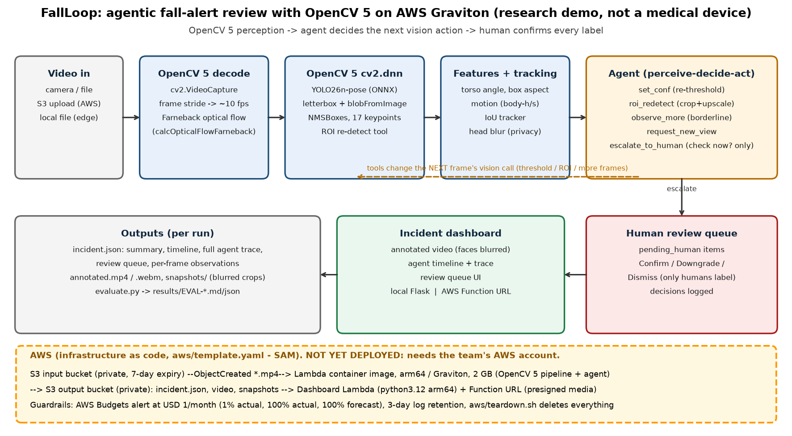
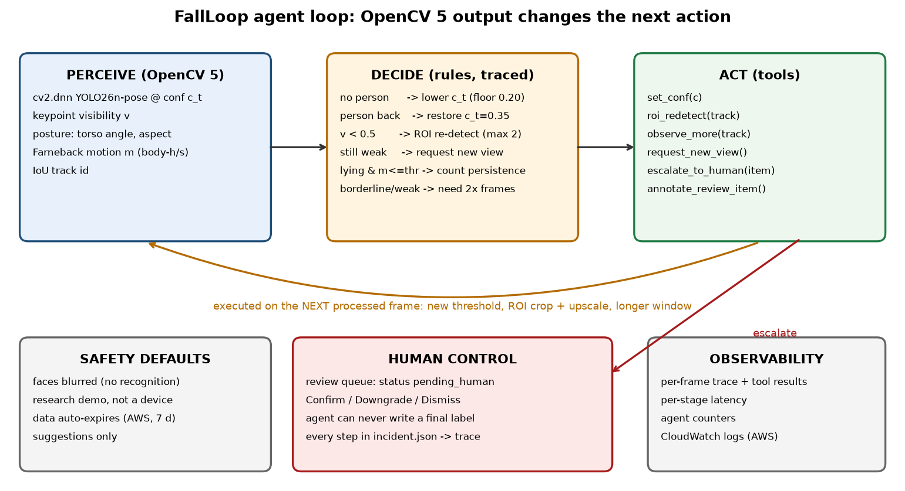

# FallLoop: agentic fall-alert review with OpenCV 5 and AWS - technical report
OpenCV AI Competition 2026. Version 2026-10-24 (solo; deployed on AWS us-east-2 on 2026-10-24).
**Research demonstration, not a medical device.** The system suggests that a person may need a check and never makes the
decision. No face recognition; faces are blurred. No real patient footage was used.

## 1. Problem and users
A person who falls at home or in a care setting and cannot get up may wait a long time before anyone notices. A person
lying still on the floor is the visual cue a caregiver looks for, but simple camera rules either miss it or raise many
false alarms (for example, someone lying down to sleep). FallLoop watches a video feed, finds people, estimates posture
and motion with OpenCV 5, and puts **possible** falls into a review queue so that a human looks at them sooner, while an
agent decides what the vision system should look at next when its evidence is weak. Intended users for this research
prototype: care-technology teams and researchers studying human-in-the-loop vision. It is not validated in real homes or
care facilities. Everything in this repository (OpenCV 5 pipeline, agent, human review, evaluation, AWS infrastructure)
was written during the competition build phase.

## 2. Architecture

Per processed frame (about 10 fps; the source is sub-sampled):
1. `cv2.VideoCapture` decode; `cv2.calcOpticalFlowFarneback` on a half-resolution grey frame.
2. `cv2.dnn.readNet` YOLO26n-pose ONNX (640x640 letterbox, `blobFromImage`), confidence filter, `cv2.dnn.NMSBoxes`, 17 keypoints mapped back to the frame.
3. Features per person: torso angle from shoulder/hip keypoints (fallback: box aspect), posture lying/sitting/standing, keypoint visibility, mean flow magnitude inside the box normalised to body-heights per second; IoU tracker for identity over time.
4. Agent (`fallloop/agent.py`) reads these observations and chooses actions:
   - `set_conf`: no person -> lower the detector threshold for the next frame (0.35 -> 0.20 floor), restore when someone is found;
   - `roi_redetect`: keypoint visibility < 0.5 -> on the next frame, crop an expanded box around that person, upscale and re-run `cv2.dnn`; keep the result if visibility improves (max 2 tries);
   - `request_new_view`: still weak after ROI tries, or nobody found at the floor threshold;
   - `observe_more`: lying + still but not yet persistent; persistence doubles (0.5 s -> 1.0 s) when motion is borderline or keypoints are weak;
   - `escalate_to_human`: lying + still persisted -> review item `pending_human` ("possible fall - check now?") with a head-blurred crop; never a final decision;
   - `annotate_review_item`: the person is later seen upright and moving -> note for the reviewer (the item stays open).
5. Outputs: annotated video (H.264 locally, WebM/VP8 written by OpenCV inside Lambda where no ffmpeg exists), `incident.json`
   (summary, timeline, full trace incl. tool results, review queue, per-frame observations), snapshots.
6. Dashboard: local Flask app or AWS dashboard Lambda, same single HTML page: annotated video, agent timeline (click to seek), review queue with human decision buttons; decisions stored in `reviews.json`.

The trace shows the vision output changing the next action. Example from `demo/run/incident.json`: at t=4.1 s keypoint
visibility 0.35 triggers `roi_redetect`; the next frame's tool result raises visibility 0.41 -> 0.59; when visibility stays
weak, `request_new_view` follows; at t=6.3-6.5 s nobody is detected and the agent lowers the threshold 0.35 -> 0.30 -> 0.25 ->
0.20, restoring 0.35 at t=7.1 s when the person is found again; at t=2.6 s a lying, still person is escalated to the human queue.

## 3. OpenCV 5 implementation notes
- OpenCV 5.0.0 (`opencv-python-headless==5.0.0.93`) for decode, resize, colour conversion, DNN inference (`cv2.dnn` with the default OpenCV backend/CPU target), NMS, optical flow, drawing, Gaussian blur and VP8 video writing.
- Model: YOLO26n-pose exported to ONNX with Ultralytics 8.4.181 (export only; Ultralytics is not a runtime dependency). Output tensor (1, 56, N) = box, score, 17x(x, y, visibility).
- Threading: `cv2.setNumThreads`; measured with 1, 2 and 4 threads (section 5).

## 4. AWS deployment (infrastructure as code; deployed in us-east-2 on 2026-10-24)
Live dashboard for judges: https://shuwf5nbecmvl633bee4crfkie0nziur.lambda-url.us-east-2.on.aws/
`aws/template.yaml` (AWS SAM, passes `cfn-lint`):
- `InBucket` / `OutBucket`: private S3 buckets (all public access blocked), SSE-S3, objects expire after 7 days.
- `ProcessFunction`: Lambda **python3.12 zip package, arm64 (Graviton)** (OpenCV 5.0.0 aarch64 wheel + ONNX model, ~165 MB unzipped), 2048 MB, 300 s, triggered by `s3:ObjectCreated` on `*.mp4`; runs the same `run_pipeline.run()` used locally; writes `results/<run_id>/...` to `OutBucket`.
- `DashboardFunction`: python3.12 arm64 zip Lambda with a public **Function URL**; serves the dashboard, lists runs, returns `incident.json`, redirects media to 10-minute presigned URLs (buckets stay private), stores reviewer decisions.
- Guardrails: AWS Budgets COST budget of USD 1/month with email alerts (1% actual, 100% actual, 100% forecast), least-privilege SAM policies, `aws/teardown.sh` to delete everything.
- Verified offline: handler code path (`LOCAL_TEST=1`), WebM fallback without ffmpeg, dashboard Lambda against an in-memory fake S3 (`tests/test_dashboard_lambda.py`). Verified on AWS (2026-10-24): stack `fallloop-demo` deployed, a real S3 upload triggered the Graviton Lambda, results reached the dashboard. Measured on AWS on 2026-10-24 (one run, the 23-second demo video, Lambda arm64/Graviton, 2048 MB, 2 OpenCV threads): 227 processed frames, mean `cv2.dnn` forward 294.7 ms and Farneback flow 51.4 ms per frame, 2.64 processed fps end to end, Lambda billed duration 114.7 s, max memory 337 MB (CloudWatch REPORT line; `results/aws-graviton-2026-10-24/`). It produced the same 3 review items as the local run (R002 0.1 s later); frames with an agent action were 37 vs 41 locally (small numeric differences on arm64). Exact commands: `DEPLOY.md`.
- COOL (Cloud-Optimized OpenCV Library): not used in this version; it is a paid Marketplace AMI for EC2, so this free-tier build does not use it.

## 5. Evaluation (full details: `results/EVAL-FALLLOOP-2026-10-24.md` / `.json`; same run as EVAL-2026-10-19)
Data: GMDCSA-24 (Alam et al., Data in Brief 2024, CC BY 4.0), 57-clip subset (every 3rd clip; 28 falls, 29 activities of
daily living, 5 of which include lying down to sleep). DEV = subjects 1-2 (used only to choose the stillness threshold),
TEST = subjects 3-4.

| Clip-level alert, TEST subjects | Precision | Recall | F1 |
|---|---|---|---|
| lying+still task (falls + sleeping are positives) | 0.786 | 0.733 | 0.759 |
| fall-only view (sleeping counts as a false alert) | 0.643 | 0.692 | 0.667 |

- Frame-level, TEST: lying precision 0.940 / recall 0.844; lying+still precision 0.948 / recall 0.786 (labels derived from activity intervals).
- Escalation: median 1.61 s after the labelled fall start (alerted falls, n=23).
- CPU speed (dedicated benchmark, 6 clips, 1280x720, shared x86_64 box): 87.9 ms per processed frame with 4 threads (11.3 fps), 103.9 ms with 2 threads, 152.4 ms with 1 thread. Largest stages: `cv2.dnn` forward ~44.5 ms, Farneback flow ~35.7 ms.
- Agent: action on 15.8% of frames; ROI re-detection improved keypoint visibility in 39 of 81 calls (48.1%); every escalation stayed `pending_human` (never decided by the system).
- Failure cases: missed falls when the detector loses a person lying on the floor (19.7% of fall-clip frames had no person vs 3.1% for daily-activity clips); false alerts on push-ups, bending and picking objects off the floor; sleeping on a bed is flagged (no bed/floor context); threshold flapping when detection flickers.
- Graviton (AWS Lambda arm64): Measured on AWS on 2026-10-24 (one run, the 23-second demo video, Lambda arm64/Graviton, 2048 MB, 2 OpenCV threads): 227 processed frames, mean `cv2.dnn` forward 294.7 ms and Farneback flow 51.4 ms per frame, 2.64 processed fps end to end, Lambda billed duration 114.7 s, max memory 337 MB (CloudWatch REPORT line; `results/aws-graviton-2026-10-24/`). It produced the same 3 review items as the local run (R002 0.1 s later); frames with an agent action were 37 vs 41 locally (small numeric differences on arm64).
- Not covered: rooms with several people, outdoor scenes, real homes or care facilities; Graviton was timed on one demo run only.

## 6. Limitations
Staged indoor clips with one actor each, four actors in total, small subgroups; posture/motion heuristics instead of a
trained classifier; no scene context (bed vs floor); the DEV-selected threshold did not transfer best to TEST; frame
timestamps assume a constant frame rate (the dataset is variable frame rate); the full evaluation was run on x86 CPU; Graviton was timed on one demo run only.

## 7. Responsible use
- Suggestions only; a human confirms or dismisses every escalation; the agent cannot write a final decision.
- No face recognition or identity features; faces (head keypoint region) blurred in video and snapshots.
- No real patient footage; evaluation data used under CC BY 4.0 with attribution.
- Cloud data minimisation: private buckets, presigned media links, 7-day expiry, 3-day logs, teardown script.
- Labelled "research demonstration, not a medical device" in the video overlay, dashboard, outputs and docs.

## 8. Reproducibility
Pinned dependencies (`requirements.txt`, `aws/requirements-lambda.txt`), deterministic data subset (`data/gmdcsa24/fetch_subset.sh`),
commands in `README.md`; evaluation: `python evaluate.py --run --bench --report && python tools/eval_to_md.py`.

## 9. Team
Igor Eduardo - engineering; Antler Founder Residency (F26, Austin); Cortexa Social Inc.

## Credits
OpenCV 5 (Apache-2.0); YOLO26n-pose by Ultralytics (AGPL-3.0 / Enterprise licence; weights not redistributed); GMDCSA-24 dataset (CC BY 4.0).
